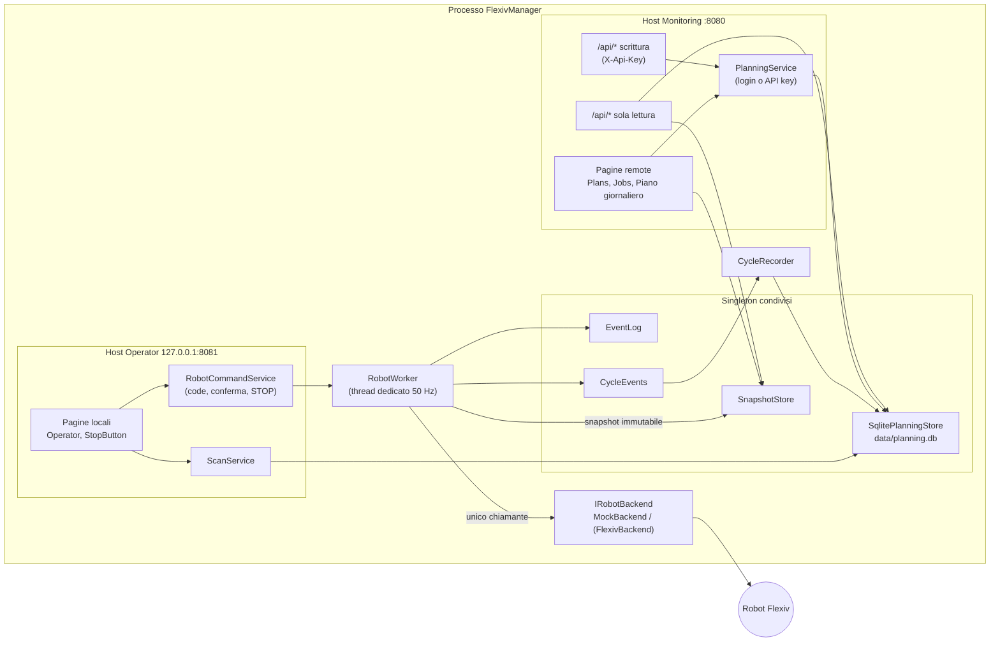

# FlexivManager – Architettura e moduli

Gateway per un cobot Flexiv Rizon. Backend di default: robot simulato (`MockBackend`). Il backend reale (`FlexivBackend`) è pronto ma non ancora provato sul robot.

> Lo STOP software non sostituisce mai l'arresto di emergenza hardware.

Identificatori, codice e commenti sono in inglese; questo documento è in italiano.

---

## 1. Visione d'insieme

Un solo processo (in futuro servizio Windows) con **due host web** che condividono lo stesso stato:

| Host | Indirizzo | Ruolo |
|------|-----------|-------|
| **Operator** (locale) | `127.0.0.1:8081`, solo loopback (verificato all'avvio) | esegue: selezione di una riga del piano di oggi o di un codice di servizio, Avvia con conferma, Pausa/Riprendi/Stop, STOP, Enable, Clear fault, esito qualità del pezzo |
| **Monitoring** (remoto) | `Hosts:Monitoring:Address`:8080 (8090 in sviluppo) | consulta e pianifica: dati robot, plan del robot, codici→plan, piano di lavoro giornaliero e report. Modifiche via pagine (login) o API REST (API key). **Nessun comando robot** |



### Regole fondamentali

1. **Solo `RobotWorker` chiama `IRobotBackend`**, sempre dal suo thread. Nessuna pagina, API o servizio parla con il robot.
2. Le pagine leggono solo lo **snapshot** (`SnapshotStore.Current`), pubblicato dal worker a ogni ciclo.
3. I comandi passano da `RobotCommandService` → coda → worker. **STOP** ha una coda propria, passa sempre per primo, annulla i comandi in coda e invalida le conferme pendenti.
4. I comandi che muovono il robot (`StartCycleCommand`, `ResumePlanCommand`) richiedono **conferma in due passi** (token monouso, 15 s). Il worker ricontrolla lo stato (`CommandPolicy`) subito prima di eseguire.
5. Il worker **non accede al database**: pubblica eventi di ciclo su `CycleEvents`, che `CycleRecorder` salva in background.
6. L'host remoto **non registra** `RobotCommandService` né `IRobotBackend`: niente di ciò che serve può muovere il robot (verificato dai test).
7. All'avvio il servizio si connette, ma **non abilita e non muove mai** il robot.

---

## 2. Progetti

| Progetto | Cartella | Dipende da | Scopo |
|----------|----------|------------|-------|
| `FlexivManager` | radice | Core, Mock, Data | Host Blazor (Interactive Server): composizione dei due host, pagine, API, login |
| `RobotGateway.Core` | `src/RobotGateway.Core` | solo `Microsoft.Extensions.*` | Logica: worker, snapshot, stati, comandi, pianificazione. Niente UI, RDK o database |
| `RobotGateway.Mock` | `src/RobotGateway.Mock` | Core | Robot simulato a 7 assi |
| `RobotGateway.Data` | `src/RobotGateway.Data` | Core, EF Core SQLite 10.0.13 | Persistenza di codici, ordini e storico cicli |
| `RobotGateway.Tests` | `tests/RobotGateway.Tests` | tutti | xUnit: unità + integrazione (worker reale + mock + SQLite + host reali) |
| `RobotGateway.Flexiv` | `src/RobotGateway.Flexiv` | Core, wrapper RDK (`third_party/flexiv_rdk_csharp`) | Backend reale (`Robot:Backend = Flexiv`), vedi §9 |

Impostazioni comuni in `Directory.Build.props` (x64, nullable, C# latest). Soluzione: `FlexivManager.slnx`.

---

## 3. RobotGateway.Core

### 3.1 Backend, worker e snapshot

| File | Contenuto |
|------|-----------|
| `Backend/IRobotBackend.cs` | Interfaccia sul sottoinsieme di `FlexivRdk.Robot` usato; `RobotBackendException` per errori di comunicazione |
| `Robot/RobotEnums.cs` | `RobotServiceState` (DISCONNECTED…ESTOP), `RobotMode`, `OperationalStatus` (sottoinsiemi RDK, da verificare) |
| `Robot/RobotStates.cs` | `RobotStates` (q, dq, tau, tau_ext, temperature, tcp_pose, ext_wrench_in_tcp) e `PlanInfo` |
| `State/RobotStateMachine.cs` | `BackendStatus` + derivazione pura dello stato di servizio (priorità: link, E-stop, fault, enable, moto) |
| `Snapshot/RobotSnapshot.cs` | Record immutabile pubblicato a ogni ciclo (stato, dati, ciclo attivo/ultimo, plan disponibili, errori) |
| `Snapshot/SnapshotStore.cs` | Ultimo snapshot, scrittore unico, lettori senza lock; evento `SnapshotUpdated` |
| `Worker/RobotWorker.cs` | `BackgroundService` con thread dedicato: comandi → autoconnessione → polling → tracciamento ciclo → refresh lista plan → pubblicazione. Arresto controllato allo shutdown |
| `Worker/RobotWorkerOptions.cs` | Opzioni sezione `Robot` (frequenza, timeout, limiti) |
| `Events/RobotEvent.cs`, `Events/EventLog.cs` | Log eventi in memoria (circolare, 500 voci), thread-safe |

### 3.2 Comandi, policy e conferma

| File | Contenuto |
|------|-----------|
| `Commands/RobotCommand.cs` | Record dei comandi (`StopCommand`, `EnableCommand`, `StartCycleCommand`, `PausePlanCommand`, …), `IsMotion`, `CommandResult` |
| `Commands/CommandPolicy.cs` | Quali comandi sono ammessi in quale stato |
| `Commands/RobotCommandService.cs` | Punto d'ingresso unico (solo host locale): code con priorità STOP, timeout con ritiro dei comandi non partiti, conferma a due passi (`RequestStartAsync`/`ConfirmAsync`), ciclo successivo di un ordine con una pressione (`CanRepeatWithoutConfirmation`, `StartNextCycleAsync`) |

### 3.3 Pianificazione: codici, piano giornaliero, cicli

| File | Contenuto |
|------|-----------|
| `Planning/Job.cs` | `Job` (codice → un plan, eseguito così come programmato in Elements; versionato; `IsService` per codici di servizio come HOME), `JobDraft`, `JobHistoryEntry`, regole `ProductCode` (normalizzazione per barcode) |
| `Planning/ProductionOrder.cs` | `ProductionOrder` = riga del piano giornaliero (giorno, codice, quantità, numero ordine facoltativo, fatti, stato, posizione), `OrderStatus` (con `CarriedOver`), `OrderDraft`, `WorkDay.Today` |
| `Planning/DailyReport.cs` | Report del giorno calcolato dalle righe: avanzamento per riga (fatto / in corso / mancante / annullato / riportato) e totali pezzi. Usato da pagina e API |
| `Planning/Cycle.cs` | `CycleRequest`, `ActiveCycle`, `CycleRecord`, `CycleOutcome` |
| `Planning/IPlanningStore.cs` | `IPlanningReader` (entrambi gli host) e `IPlanningStore` (scritture); `PlanningConflictException` |
| `Planning/PlanningValidator.cs` | Normalizzazione e validazione lato server di codici e righe |
| `Planning/PlanningService.cs` | Modifiche remote (solo host remoto, da pagine e API): controllo login, validazione, giorno non passato, "copia mancanti", report, log di chi/cosa |
| `Planning/ScanService.cs` | Risoluzione barcode (solo host locale): prima riga aperta di oggi con quel codice; codice di servizio senza riga; altrimenti rifiutato |
| `Planning/CycleRecorder.cs` | `CycleEvents` (passaggio non bloccante dal worker) e `CycleRecorder` (salva cicli, attiva/conta/completa righe) |

**Regole del piano giornaliero**
- L'operatore vede ed esegue solo le righe aperte del piano di **oggi** (data locale del PC), in qualsiasi ordine. I codici di servizio sono sempre disponibili e non si contano.
- Una riga si completa quando i pezzi fatti raggiungono la quantità. Rilavora toglie il pezzo dai fatti: la riga può riaprirsi.
- A fine giornata i pezzi mancanti restano "mancanti" nel report. "Copia mancanti" crea nel giorno successivo (o oggi, se il successivo è già passato) nuove righe con la quantità rimanente e chiude le originali come `CarriedOver`.

---

### 3.4 Interfaccia con il gestionale (`Erp/`)

- `ArticleFile`: legge il file del gestionale (un codice per riga, codifica, righe scartate).
- `ArticleImporter`: legge la cartella `Erp:ImportFolder`, salva i codici (`IErpStore`, tabella `Articles`) e
  **solo dopo** cancella il file (conferma al gestionale). Una lettura alla volta; `LastScan` per pagina e API.
- `ArticleImportService`: lettura automatica ogni `Erp:PollInterval`, registrata sull'host operatore (sempre
  attivo); la lettura manuale (`POST /api/erp/articles/import`, pulsante in Codici lavoro) è sull'host remoto.
- `ProductionExport` / `ProductionExportService`: dati di produzione del giorno per codice articolo, calcolati
  dai cicli registrati (`Cycles`), dagli ordini del giorno e dal ciclo in corso nella snapshot.

Dettagli in [INTEGRAZIONE-GESTIONALE.md](INTEGRAZIONE-GESTIONALE.md).

## 4. RobotGateway.Mock

| File | Contenuto |
|------|-----------|
| `MockBackend.cs` | Robot simulato (7 giunti) guidato da `TimeProvider`: connect → NOT_ENABLED → Enable → RELEASING_BRAKE → operativo; plan solo in NRT_PLAN_EXECUTION; Stop → IDLE. Hook di test: `InjectFault`, `SetEStop`, `SimulateLinkLoss` |
| `MockBackendOptions.cs` | Plan simulati (PickPlace, Polish, Home, FaultDemo) e ritardo di abilitazione |

---

## 5. RobotGateway.Data

| File | Contenuto |
|------|-----------|
| `PlanningDbContext.cs` | Tabelle `Jobs`, `JobHistory`, `Orders` (righe del piano, con `WorkDate`), `Cycles` (con esito qualità), con indici e token di concorrenza |
| `SqlitePlanningStore.cs` | Implementa `IPlanningStore`: scritture serializzate, controllo versioni (avviso di conflitto), regole delle righe (solo le Pending si modificano/spostano nel loro giorno, numero ordine unico tra gli aperti se indicato), conteggio, esiti qualità, "copia mancanti" |
| `DataServiceCollectionExtensions.cs` | `PlanningStoreOptions` (sezione `Planning`) e registrazione DI |

Schema creato al primo avvio (`EnsureCreated`). Le colonne nuove vengono aggiunte all'avvio (`ALTER TABLE` in `EnsureCreated`): le righe create prima del piano giornaliero prendono come giorno la data di creazione.

---

## 6. Host FlexivManager

### 6.1 Composizione, ruoli e sicurezza

| File | Contenuto |
|------|-----------|
| `Program.cs` | Avvio; comando di utilità `hash-password <password>` |
| `Hosting/GatewayComposition.cs` | Costruisce i due host: servizi condivisi, cosa è registrato dove, pipeline, creazione DB e dati demo |
| `Hosting/MonitoringHostService.cs` | Avvia/ferma l'host remoto insieme a quello locale; se il remoto non parte, il locale (con lo STOP) resta attivo |
| `Hosting/HostOptions.cs` | Indirizzi, login, `HostRole` (`CanCommand`/`CanEdit`), nome policy `Planner` |
| `Hosting/AccountEndpoints.cs` | Login a utente singolo (pagina HTML + POST con antiforgery, cookie) e logout. Solo host remoto |
| `Hosting/PasswordHasher.cs` | Hash PBKDF2-SHA256 della password |
| `Hosting/DemoSeed.cs` | Codici e righe di esempio (solo sviluppo, `Planning:SeedDemoData`) |
| `Api/ReadOnlyApi.cs` | API GET aperta, entrambi gli host: `/api/status`, `/telemetry`, `/events`, `/plans`, `/jobs`, `/orders`, `/cycles`, `/plan`, `/report` |
| `Api/PlanningApi.cs` | API di scrittura, solo host remoto, header `X-Api-Key`: codici e righe del piano (crea, modifica, annulla, sposta, copia mancanti). Passa da `PlanningService` come le pagine. Dettagli in [API-REST.md](API-REST.md) |

### 6.2 Cosa è registrato su ciascun host

| Servizio | Operator (locale) | Monitoring (remoto) |
|----------|:-:|:-:|
| `IRobotBackend`, `RobotWorker`, `CycleRecorder` | ✔ | ✘ |
| `RobotCommandService` | ✔ | ✘ |
| `ScanService` | ✔ | ✘ |
| `PlanningService` (modifiche) | ✘ | ✔ (login o API key) |
| API di scrittura `/api/...` | ✘ | ✔ (API key) |
| `IPlanningReader`, `SnapshotStore`, `EventLog` | ✔ | ✔ (stesse istanze) |
| Login cookie | ✘ | ✔ |

### 6.3 Pagine e componenti

| File | Host | Contenuto |
|------|------|-----------|
| `Components/Pages/Operator.razor` | locale | Zona codice (lettore barcode USB in emulazione tastiera, anche tastiera; popup se il codice non è accettato), START e STOP grandi (conferma sul primo pezzo di una riga), Enable/Clear fault, piano di oggi in sola lettura (da fare / in corso / fatto) |
| `Components/Robot/StopButton.razor` | locale | STOP software; non compare dove manca il servizio comandi |
| `Components/Pages/RobotStatus.razor` | entrambi | Diagnostica: stato, giunti, pose TCP, forze, eventi |
| `Components/Pages/RobotPlans.razor` | remoto | Plan presenti sul robot e codici che li usano |
| `Components/Pages/Jobs.razor`, `JobEdit.razor` | remoto | Elenco codici (aperto) e modifica (login) con storico |
| `Components/Pages/Orders.razor` (`/orders`, `/plan`) | remoto | Piano giornaliero con scelta del giorno e report (pezzi fatti/mancanti, righe fatte/in corso/mancanti); aggiungi, sposta, annulla, "copia mancanti"; ultimi cicli con esito |
| `Components/Pages/OrderEdit.razor` | remoto | Nuova riga / modifica di una riga non iniziata: giorno, codice, quantità, numero ordine facoltativo, note |
| `Components/Planning/PlannerAccount.razor`, `RedirectToLogin.razor` | remoto | Stato login, logout, reindirizzamento al login |
| `Components/Routes.razor` | entrambi | Routing con autorizzazione (`AuthorizeRouteView`) |

**File del thread GUI** (aspetto: layout, menu, stile; modificati da quel thread): `Components/App.razor`, `Components/Layout/*` (`MainLayout`, `NavMenu`, `RobotStatusBar`, `RobotStateStyle`, `ReconnectModal`), `wwwroot/*` (`app.css`, icone, logo).

---

## 7. Configurazione (`appsettings.json`)

| Chiave | Default | Significato |
|--------|---------|-------------|
| `Hosts:Operator:Address` / `Port` | `127.0.0.1` / `8081` | Host locale; deve essere loopback |
| `Hosts:Monitoring:Enabled` | `true` | Avvia l'host remoto |
| `Hosts:Monitoring:Address` / `Port` | `127.0.0.1` / `8080` (8090 in sviluppo) | Impostare l'IP della rete interna in produzione |
| `Hosts:Monitoring:RequireLoginForEdit` | `true` | Login per le modifiche remote |
| `Hosts:Monitoring:Editor:UserName` / `PasswordHash` | `planner` / vuoto | Hash da `FlexivManager.exe hash-password …`; vuoto = pianificazione in sola lettura |
| `Hosts:Monitoring:Api:Key` | vuoto (`dev-api-key` in sviluppo) | Chiave dell'API di scrittura (header `X-Api-Key`); vuoto = API di scrittura disattivata. In produzione: valore lungo e casuale, fuori dal controllo sorgenti |
| `Hosts:Monitoring:Api:ClientName` | `api` | Nome registrato in "modificato da" e nel log per le modifiche via API |
| `Planning:DatabasePath` | `data/planning.db` | File SQLite |
| `Planning:SeedDemoData` | `false` (`true` in sviluppo) | Dati di esempio se il DB è vuoto |
| `Robot:PollRateHz` | `50` | Frequenza del worker |
| `Robot:AutoConnect` / `ReconnectInterval` | `true` / 3 s | Connessione e riconnessione automatica (mai abilitazione) |
| `Robot:DefaultCommandTimeout` | 5 s | Timeout comandi |
| `Robot:ConfirmationTimeout` | 15 s | Validità del token di conferma |
| `Robot:PlanStartTimeout` | 5 s | Il plan avviato deve risultare in esecuzione entro questo tempo |
| `Robot:PlanListRefreshInterval` | 10 s | Rilettura della lista plan a robot fermo |
| `Robot:Mock:EnableDelay` | 1.5 s | Solo simulatore |
| `Robot:Backend` | `Mock` | `Mock` = simulatore, `Flexiv` = robot reale |
| `Robot:Flexiv:SerialNumber` | `Rizon4-062609` | Numero di serie del robot |
| `Robot:Flexiv:RdkVersion` | `1.8` | Nome della cartella `native/rdk-<versione>` (deve corrispondere al software del robot). Se non esiste, il programma si ferma all'avvio con un messaggio chiaro |
| `Robot:Flexiv:NetworkInterfaces` | vuoto | IP locali da usare per cercare il robot (vuoto = tutte) |
| `Robot:Flexiv:ClearFaultTimeoutSeconds` | 3 | Attesa massima di ClearFault |

---

## 8. Test (`tests/RobotGateway.Tests`)

| File | Copre |
|------|-------|
| `RobotStateMachineTests.cs`, `CommandPolicyTests.cs` | Derivazione stati, comandi ammessi |
| `SnapshotAndCommandServiceTests.cs` | Code, priorità STOP, ritiro su timeout, conferma, ciclo successivo con una pressione |
| `MockBackendTests.cs` | Comportamento del simulatore |
| `PlanningTests.cs` | Normalizzazione codici, validazione, login per modifiche, conflitti, barcode sul piano di oggi, report giornaliero |
| `PlanningStoreTests.cs` | Righe per giorno, spostamenti, conteggio, completamento, annullamento, esiti qualità, copia mancanti (SQLite reale) |
| `RobotWorkerTests.cs` | Integrazione: ordini completi, fault non contato, STOP, pausa, modifiche durante il ciclo |
| `HostingTests.cs` | Due host reali: servizi per host, API in lettura, API di scrittura con/senza chiave, login, porta occupata, indirizzo non loopback |
| `TestPlanning.cs`, `ManualTimeProvider.cs` | Supporto ai test |

---

## 9. Wrapper Flexiv e backend reale

Il wrapper C# di Flexiv RDK è usato **in un solo punto**: il progetto `src/RobotGateway.Flexiv`, che implementa `IRobotBackend`. Il resto del codice non lo conosce. La scelta tra simulatore e robot si fa con `Robot:Backend` (`Mock` di default, oppure `Flexiv`).

### 9.1 Compatibilità robot ↔ RDK

Fonte: tabella ufficiale Flexiv (robot_software_compatibility). Se le versioni non corrispondono, RDK rifiuta la connessione.

| Software robot | flexiv_rdk | Cartella nativa | `Robot:Flexiv:RdkVersion` |
|----------------|-----------|-----------------|---------------------------|
| 3.10.x (primo robot di test: Rizon 4-062609, 3.10.3, control box Hesper-062978) | v1.8 | `native/rdk-1.8/` | `1.8` |
| 3.11.3 | v1.9.4.1 | `native/rdk-1.9.4.1/` | `1.9.4.1` |

### 9.2 File

| File | Contenuto |
|------|-----------|
| `third_party/flexiv_rdk_csharp/` | Wrapper ufficiale copiato nel repo, fissato al commit `37a09c2` (Apache 2.0). Origine e modifiche in `README.md` e `LOCAL_CHANGES.md` |
| `third_party/flexiv_rdk_csharp/FlexivRdk.csproj` | Compila le classi C# del wrapper come libreria |
| `third_party/build-native.ps1` | Compila la DLL nativa per una versione RDK (x64 Release) e la copia in `src/RobotGateway.Flexiv/native/rdk-<tag>/` con `VERSION.txt` |
| `src/RobotGateway.Flexiv/FlexivBackend.cs` | `FlexivBackend : IRobotBackend`: solo le funzioni comuni a RDK 1.8 e 1.9 |
| `src/RobotGateway.Flexiv/FlexivMapping.cs` | Conversioni di enum, stati, plan info ed eventi tra wrapper e Core |
| `src/RobotGateway.Flexiv/NativeRdkLoader.cs` | Carica le DLL della versione configurata da `native/rdk-<tag>/` e controlla all'avvio che esista |
| `src/RobotGateway.Flexiv/EventLogCursor.cs` | Restituisce solo le voci nuove del log eventi del robot |
| `src/RobotGateway.Flexiv/FlexivBackendOptions.cs` | Sezione `Robot:Flexiv` |

**Compilazione nativa:** dalla cartella della soluzione, in PowerShell:

```powershell
./third_party/build-native.ps1 -RdkTag v1.8
```

Lo script:
1. clona flexiv_rdk al tag indicato (la libreria RDK precompilata viene scaricata dalla release GitHub ufficiale, con verifica SHA256);
2. compila le dipendenze (Eigen, spdlog, tinyxml2, Fast-DDS, …);
3. compila il wrapper.

Richiede Visual Studio con il carico di lavoro C++ e Git per Windows. Lavora in `%USERPROFILE%\fxrdk`, fuori dal repo.

Dalla v1.9.4 RDK è una DLL precompilata e autosufficiente, scaricata dalla release ufficiale con verifica SHA256: lo script compila solo Eigen e il wrapper, e copia la DLL RDK accanto al wrapper. Le versioni da v1.9.0 a v1.9.3 non sono gestite: compilazione statica con molte più dipendenze, e il wrapper richiede almeno la v1.9.3.

Il wrapper upstream è scritto per RDK 1.9. Le funzioni assenti in 1.8 (`actions`, `reached_timeliness_failure_limit`, `SendMultiCartesianMotionForce`, `Device::enabled`, `Model::SyncKinematicsYAML`, firma di `SetTimelinessFailureLimit`) sono protette dalla macro `FLEXIV_RDK_API`. Il gateway non usa nessuna di queste funzioni.

### 9.3 Corrispondenza `IRobotBackend` → wrapper

| `IRobotBackend` | Wrapper (`FlexivRdk.Robot`) | Note |
|-----------------|-----------------------------|------|
| `Connect()` | `new Robot(serial, interfaces, verbose, lite: false)` | Blocca finché il robot è trovato e connesso, o finché fallisce: in quel tempo il worker non pubblica (il robot non si muove, perché non connesso). Il numero di serie è accettato con o senza spazio ("Rizon 4-062609" / "Rizon4-062609") |
| `Disconnect()` / `Dispose()` | `Dispose()` | |
| `IsConnected` | `connected()` | Mai eccezioni |
| `IsOperational`, `OperationalStatus` | `operational()`, `operational_status()` | Enum completo mappato |
| `IsFault`, `IsEStopReleased`, `Mode` | `fault()`, `estop_released()`, `mode()` | |
| `IsBusy` | `busy()` | Secondo `robot.hpp` indica se il plan è terminato: è il segnale di fine ciclo. **Da verificare** se resta vero in pausa |
| `ReadStates()` | `states()` | Array tagliati sui DoF reali (`SystemDoF`); unità invariate |
| `GetPlanList()`, `GetPlanInfo()` | `plan_list()`, `plan_info()` | |
| `Enable()` | `Enable()` | Lo stato operativo arriva dal polling |
| `ClearFault()` | `ClearFault(timeout)` | **Bloccante** fino a `ClearFaultTimeoutSeconds` (3 s); il robot è in fault, quindi fermo |
| `SwitchMode(mode)` | `SwitchMode(...)` | Solo modi NRT; i modi RT non sono mai usati |
| `SetVelocityScale(p)` | `SetVelocityScale(p)` | Solo dal worker, sempre a 100 % prima di ogni plan: il plan gira alle velocità programmate in Elements, senza ereditare un override lasciato da Elements o dal pendant |
| `ExecutePlan(name, false)` | `ExecutePlan(name, false, blockUntilStarted: true)` | Ritorna a plan avviato (tipicamente < 200 ms) |
| `PausePlan(bool)` | `PausePlan(bool)` | I plan interni (non creati dall'utente) non si possono riprendere |
| `StopPlan()` | `StopPlan()` | NRT_PLAN_EXECUTION |
| `Stop()` | `Stop()` | Ferma e porta in IDLE |
| `DrainEventLog()` | `event_log()` | **Da verificare** se il log è cumulativo; `EventLogCursor` passa comunque solo le voci nuove |

Stranezza nota: `enabling_button_pressed()` chiama la funzione nativa `EnablingButtonReleased`, quindi il valore potrebbe essere invertito. Il gateway non la usa.

### 9.4 Errori

Il wrapper segnala ogni errore nativo come `System.Exception` con `[Flexiv RDK Error 1] <messaggio>`. Il codice è sempre 1, e il tipo C++ dell'eccezione va perso. `FlexivBackend` decide quindi in base allo stato del collegamento subito dopo l'errore:
- collegamento caduto → `RobotBackendException`: il worker la tratta come perdita di connessione e riconnette;
- collegamento attivo → `InvalidOperationException` con il messaggio RDK (per esempio modo errato): il comando risulta fallito, senza disconnettere.

### 9.5 Cosa non cambia

- Core, Data, pagine, API e test esistenti vedono solo `IRobotBackend`.
- Solo `RobotWorker` chiama il backend, sempre dallo stesso thread.
- Nessuna abilitazione e nessun movimento all'avvio; STOP sempre disponibile.
- I test girano sul Mock. Per il robot reale serve un gruppo di prove manuali, con il robot in modalità remota e la cella sgombra.

### 9.6 Primo collegamento al robot reale (checklist)

1. PC sulla rete del robot; da Flexiv Elements, RDK abilitato e robot in modalità di controllo remoto.
2. DLL nativa presente in `src/RobotGateway.Flexiv/native/rdk-1.8/` (compilata con lo script).
3. In `appsettings.json`: `Robot:Backend = Flexiv`; serial e `RdkVersion` sono già impostati.
4. Avviare: il servizio si **connette soltanto**. Verificare su `/robot` lo stato, i giunti, i plan letti e gli eventi.
5. Solo dopo: Enable dalla pagina Operator, poi un codice con un plan breve (velocità basse impostate nel plan stesso, in Elements), con la mano sull'arresto di emergenza.
