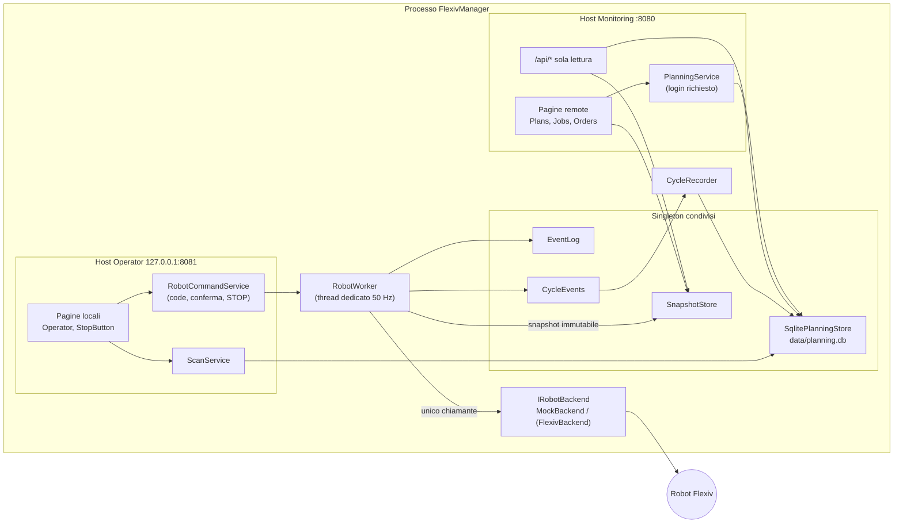

# FlexivManager – Architettura e moduli

Gateway per un cobot Flexiv Rizon. Stato attuale: **solo robot simulato** (`MockBackend`); nessun robot reale viene contattato.

> Lo STOP software non sostituisce mai l'arresto di emergenza hardware.

Identificatori, codice e commenti sono in inglese; questo documento è in italiano.

---

## 1. Visione d'insieme

Un solo processo (in futuro servizio Windows) con **due host web** che condividono lo stesso stato:

| Host | Indirizzo | Ruolo |
|------|-----------|-------|
| **Operator** (locale) | `127.0.0.1:8081`, solo loopback (verificato all'avvio) | esegue: selezione codice/ordine, Avvia con conferma, Pausa/Riprendi/Stop, STOP, Enable, Clear fault |
| **Monitoring** (remoto) | `Hosts:Monitoring:Address`:8080 (8090 in sviluppo) | consulta e pianifica: dati robot, plan del robot, codici→plan, lista ordini. **Nessun comando robot** |



### Regole fondamentali

1. **Solo `RobotWorker` chiama `IRobotBackend`**, sempre dal suo thread. Nessuna pagina, API o servizio parla con il robot.
2. Le pagine leggono solo lo **snapshot** (`SnapshotStore.Current`), pubblicato dal worker a ogni ciclo.
3. I comandi passano da `RobotCommandService` → coda → worker. **STOP** ha una coda propria, passa sempre per primo, annulla i comandi in coda e invalida le conferme pendenti.
4. I comandi che muovono il robot (`StartCycleCommand`, `ResumePlanCommand`) richiedono **conferma in due passi** (token monouso, 15 s). Il worker ricontrolla lo stato (`CommandPolicy`) subito prima di eseguire.
5. Il worker **non accede al database**: pubblica eventi di ciclo su `CycleEvents`, che `CycleRecorder` salva in background.
6. L'host remoto **non registra** `RobotCommandService` né `IRobotBackend`: niente di ciò che serve può muovere il robot (verificato dai test).
7. All'avvio il servizio si connette, ma **non abilita e non muove mai** il robot.

---

## 2. Progetti

| Progetto | Cartella | Dipende da | Scopo |
|----------|----------|------------|-------|
| `FlexivManager` | radice | Core, Mock, Data | Host Blazor (Interactive Server): composizione dei due host, pagine, API, login |
| `RobotGateway.Core` | `src/RobotGateway.Core` | solo `Microsoft.Extensions.*` | Logica: worker, snapshot, stati, comandi, pianificazione. Niente UI, RDK o database |
| `RobotGateway.Mock` | `src/RobotGateway.Mock` | Core | Robot simulato a 7 assi |
| `RobotGateway.Data` | `src/RobotGateway.Data` | Core, EF Core SQLite 10.0.13 | Persistenza di codici, ordini e storico cicli |
| `RobotGateway.Tests` | `tests/RobotGateway.Tests` | tutti | xUnit: unità + integrazione (worker reale + mock + SQLite + host reali) |
| *(futuro)* `RobotGateway.Flexiv` | `src/RobotGateway.Flexiv` | Core, wrapper RDK | Backend reale, vedi §9 |

Impostazioni comuni in `Directory.Build.props` (x64, nullable, C# latest). Soluzione: `FlexivManager.slnx`.

---

## 3. RobotGateway.Core

### 3.1 Backend, worker e snapshot

| File | Contenuto |
|------|-----------|
| `Backend/IRobotBackend.cs` | Interfaccia sul sottoinsieme di `FlexivRdk.Robot` usato; `RobotBackendException` per errori di comunicazione |
| `Robot/RobotEnums.cs` | `RobotServiceState` (DISCONNECTED…ESTOP), `RobotMode`, `OperationalStatus` (sottoinsiemi RDK, da verificare) |
| `Robot/RobotStates.cs` | `RobotStates` (q, dq, tau, tau_ext, temperature, tcp_pose, ext_wrench_in_tcp) e `PlanInfo` |
| `State/RobotStateMachine.cs` | `BackendStatus` + derivazione pura dello stato di servizio (priorità: link, E-stop, fault, enable, moto) |
| `Snapshot/RobotSnapshot.cs` | Record immutabile pubblicato a ogni ciclo (stato, dati, ciclo attivo/ultimo, plan disponibili, errori) |
| `Snapshot/SnapshotStore.cs` | Ultimo snapshot, scrittore unico, lettori senza lock; evento `SnapshotUpdated` |
| `Worker/RobotWorker.cs` | `BackgroundService` con thread dedicato: comandi → autoconnessione → polling → tracciamento ciclo → refresh lista plan → pubblicazione. Arresto controllato allo shutdown |
| `Worker/RobotWorkerOptions.cs` | Opzioni sezione `Robot` (frequenza, timeout, limiti) |
| `Events/RobotEvent.cs`, `Events/EventLog.cs` | Log eventi in memoria (circolare, 500 voci), thread-safe |

### 3.2 Comandi, policy e conferma

| File | Contenuto |
|------|-----------|
| `Commands/RobotCommand.cs` | Record dei comandi (`StopCommand`, `EnableCommand`, `StartCycleCommand`, `PausePlanCommand`, …), `IsMotion`, `CommandResult` |
| `Commands/CommandPolicy.cs` | Quali comandi sono ammessi in quale stato; limiti di velocità |
| `Commands/RobotCommandService.cs` | Punto d'ingresso unico (solo host locale): code con priorità STOP, timeout con ritiro dei comandi non partiti, conferma a due passi (`RequestStartAsync`/`ConfirmAsync`), ciclo successivo di un ordine con una pressione (`CanRepeatWithoutConfirmation`, `StartNextCycleAsync`) |

### 3.3 Pianificazione: codici, ordini, cicli

| File | Contenuto |
|------|-----------|
| `Planning/Job.cs` | `Job` (codice → un plan + velocità, versionato), `JobDraft`, `JobHistoryEntry`, regole `ProductCode` (normalizzazione per barcode) |
| `Planning/ProductionOrder.cs` | `ProductionOrder` (numero, codice, quantità, fatti, stato, posizione), `OrderStatus`, `OrderDraft` |
| `Planning/Cycle.cs` | `CycleRequest`, `ActiveCycle`, `CycleRecord`, `CycleOutcome` |
| `Planning/IPlanningStore.cs` | `IPlanningReader` (entrambi gli host) e `IPlanningStore` (scritture); `PlanningConflictException` |
| `Planning/PlanningValidator.cs` | Normalizzazione e validazione lato server di codici e ordini |
| `Planning/PlanningService.cs` | Modifiche remote (solo host remoto): controllo login, validazione, log di chi/cosa |
| `Planning/ScanService.cs` | Risoluzione barcode (solo host locale): primo ordine aperto con quel codice, altrimenti lavoro singolo |
| `Planning/CycleRecorder.cs` | `CycleEvents` (passaggio non bloccante dal worker) e `CycleRecorder` (salva cicli, attiva/conta/completa ordini) |

---

## 4. RobotGateway.Mock

| File | Contenuto |
|------|-----------|
| `MockBackend.cs` | Robot simulato (7 giunti) guidato da `TimeProvider`: connect → NOT_ENABLED → Enable → RELEASING_BRAKE → operativo; plan solo in NRT_PLAN_EXECUTION; Stop → IDLE. Hook di test: `InjectFault`, `SetEStop`, `SimulateLinkLoss` |
| `MockBackendOptions.cs` | Plan simulati (PickPlace, Polish, Home, FaultDemo) e ritardo di abilitazione |

---

## 5. RobotGateway.Data

| File | Contenuto |
|------|-----------|
| `PlanningDbContext.cs` | Tabelle `Jobs`, `JobHistory`, `Orders`, `Cycles`, con indici e token di concorrenza |
| `SqlitePlanningStore.cs` | Implementa `IPlanningStore`: scritture serializzate, controllo versioni (avviso di conflitto), regole degli ordini (solo i Pending si modificano/spostano, numero unico tra gli aperti), conteggio e completamento |
| `DataServiceCollectionExtensions.cs` | `PlanningStoreOptions` (sezione `Planning`) e registrazione DI |

Schema creato al primo avvio (`EnsureCreated`). Le modifiche future allo schema richiederanno le migrazioni EF.

---

## 6. Host FlexivManager

### 6.1 Composizione, ruoli e sicurezza

| File | Contenuto |
|------|-----------|
| `Program.cs` | Avvio; comando di utilità `hash-password <password>` |
| `Hosting/GatewayComposition.cs` | Costruisce i due host: servizi condivisi, cosa è registrato dove, pipeline, creazione DB e dati demo |
| `Hosting/MonitoringHostService.cs` | Avvia/ferma l'host remoto insieme a quello locale; se il remoto non parte, il locale (con lo STOP) resta attivo |
| `Hosting/HostOptions.cs` | Indirizzi, login, `HostRole` (`CanCommand`/`CanEdit`), nome policy `Planner` |
| `Hosting/AccountEndpoints.cs` | Login a utente singolo (pagina HTML + POST con antiforgery, cookie) e logout. Solo host remoto |
| `Hosting/PasswordHasher.cs` | Hash PBKDF2-SHA256 della password |
| `Hosting/DemoSeed.cs` | Codici e ordini di esempio (solo sviluppo, `Planning:SeedDemoData`) |
| `Api/ReadOnlyApi.cs` | API GET: `/api/status`, `/telemetry`, `/events`, `/plans`, `/jobs`, `/orders`, `/cycles` |

### 6.2 Cosa è registrato su ciascun host

| Servizio | Operator (locale) | Monitoring (remoto) |
|----------|:-:|:-:|
| `IRobotBackend`, `RobotWorker`, `CycleRecorder` | ✔ | ✘ |
| `RobotCommandService` | ✔ | ✘ |
| `ScanService` | ✔ | ✘ |
| `PlanningService` (modifiche) | ✘ | ✔ (login) |
| `IPlanningReader`, `SnapshotStore`, `EventLog` | ✔ | ✔ (stesse istanze) |
| Login cookie | ✘ | ✔ |

### 6.3 Pagine e componenti

| File | Host | Contenuto |
|------|------|-----------|
| `Components/Pages/Operator.razor` | locale | Campo barcode (lettore USB in emulazione tastiera), lista ordini, lavoro singolo, Avvia con dialogo di conferma, esecuzione, Pausa/Riprendi/Stop/STOP, Enable/Clear fault |
| `Components/Robot/StopButton.razor` | locale | STOP software; non compare dove manca il servizio comandi |
| `Components/Pages/RobotStatus.razor` | entrambi | Diagnostica: stato, giunti, pose TCP, forze, eventi |
| `Components/Pages/RobotPlans.razor` | remoto | Plan presenti sul robot e codici che li usano |
| `Components/Pages/Jobs.razor`, `JobEdit.razor` | remoto | Elenco codici (aperto) e modifica (login) con storico |
| `Components/Pages/Orders.razor`, `OrderEdit.razor` | remoto | Lista ordini: aggiungi, modifica, sposta, annulla; ordini chiusi e storico cicli |
| `Components/Planning/PlannerAccount.razor`, `RedirectToLogin.razor` | remoto | Stato login, logout, reindirizzamento al login |
| `Components/Routes.razor` | entrambi | Routing con autorizzazione (`AuthorizeRouteView`) |

**File del thread GUI** (aspetto: layout, menu, stile; modificati da quel thread): `Components/App.razor`, `Components/Layout/*` (`MainLayout`, `NavMenu`, `RobotStatusBar`, `RobotStateStyle`, `ReconnectModal`), `wwwroot/*` (`app.css`, icone, logo).

---

## 7. Configurazione (`appsettings.json`)

| Chiave | Default | Significato |
|--------|---------|-------------|
| `Hosts:Operator:Address` / `Port` | `127.0.0.1` / `8081` | Host locale; deve essere loopback |
| `Hosts:Monitoring:Enabled` | `true` | Avvia l'host remoto |
| `Hosts:Monitoring:Address` / `Port` | `127.0.0.1` / `8080` (8090 in sviluppo) | Impostare l'IP della rete interna in produzione |
| `Hosts:Monitoring:RequireLoginForEdit` | `true` | Login per le modifiche remote |
| `Hosts:Monitoring:Editor:UserName` / `PasswordHash` | `planner` / vuoto | Hash da `FlexivManager.exe hash-password …`; vuoto = pianificazione in sola lettura |
| `Planning:DatabasePath` | `data/planning.db` | File SQLite |
| `Planning:SeedDemoData` | `false` (`true` in sviluppo) | Dati di esempio se il DB è vuoto |
| `Robot:PollRateHz` | `50` | Frequenza del worker |
| `Robot:AutoConnect` / `ReconnectInterval` | `true` / 3 s | Connessione e riconnessione automatica (mai abilitazione) |
| `Robot:DefaultCommandTimeout` | 5 s | Timeout comandi |
| `Robot:ConfirmationTimeout` | 15 s | Validità del token di conferma |
| `Robot:MaxVelocityScale` | `100` | Limite globale della velocità dei codici |
| `Robot:PlanStartTimeout` | 5 s | Il plan avviato deve risultare in esecuzione entro questo tempo |
| `Robot:PlanListRefreshInterval` | 10 s | Rilettura della lista plan a robot fermo |
| `Robot:Mock:EnableDelay` | 1.5 s | Solo simulatore |

---

## 8. Test (`tests/RobotGateway.Tests`)

| File | Copre |
|------|-------|
| `RobotStateMachineTests.cs`, `CommandPolicyTests.cs` | Derivazione stati, comandi ammessi |
| `SnapshotAndCommandServiceTests.cs` | Code, priorità STOP, ritiro su timeout, conferma, ciclo successivo con una pressione |
| `MockBackendTests.cs` | Comportamento del simulatore |
| `PlanningTests.cs` | Normalizzazione codici, validazione, login per modifiche, conflitti, barcode |
| `PlanningStoreTests.cs` | Ordinamento, spostamenti, conteggio, completamento, annullamento (SQLite reale) |
| `RobotWorkerTests.cs` | Integrazione: ordini completi, fault non contato, STOP, pausa, modifiche durante il ciclo |
| `HostingTests.cs` | Due host reali: servizi per host, API, login, porta occupata, indirizzo non loopback |
| `TestPlanning.cs`, `ManualTimeProvider.cs` | Supporto ai test |

---

## 9. Dove si innesta il wrapper Flexiv

Il wrapper C# di Flexiv RDK va usato **in un solo punto**: un nuovo progetto che implementa `IRobotBackend`. Nient'altro nel codice deve conoscerlo.

### 9.1 Struttura proposta

```
src/RobotGateway.Flexiv/
  RobotGateway.Flexiv.csproj     x64, riferimento a RobotGateway.Core
  FlexivBackend.cs               FlexivBackend : IRobotBackend
  FlexivBackendOptions.cs        numero di serie del robot, interfacce di rete, timeout (sezione Robot:Flexiv)
  Mapping.cs                     conversioni enum/array RDK <-> Core
  Wrapper/                       sorgenti .cs del wrapper copiati e fissati a un commit preciso
  native/                        DLL native compilate per la versione RDK del robot, copiate nella cartella di output
```

- **Versione:** il wrapper e le DLL native vanno allineati alla versione RDK compatibile con il software del robot. Registrare commit e versione in un `native/VERSION.txt`.
- **Piattaforma:** solo x64. Nel `.csproj`: `<None Include="native\**" CopyToOutputDirectory="PreserveNewest" />`.
- **Scelta del backend da configurazione** (`Robot:Backend = Mock | Flexiv`, default `Mock`), in `GatewayComposition.AddRobotGateway`: registra `MockBackend` oppure `FlexivBackend` come `IRobotBackend`. Il Mock resta per sviluppo e test.

### 9.2 Corrispondenza `IRobotBackend` → RDK

Wrapper ufficiale: <https://github.com/flexivrobotics/flexiv_rdk_csharp> (`csharp/FlexivRdk/Robot.cs`). I nomi a destra sono quelli di quel wrapper (che segue l'API C++). Vanno riverificati sulla versione effettivamente scelta.

**Versione:** il CMake del repository indica RDK 1.9.3, ma lo script in `third_party` scarica flexiv_rdk v1.7. Le DLL native vanno ricompilate dal tag RDK che corrisponde al software del robot.

| `IRobotBackend` | Chiamata RDK | Note |
|-----------------|--------------|------|
| `Connect()` | costruzione `Robot(serial, …)` | Può bloccare alcuni secondi: avviene nel thread del worker, che in quel tempo non pubblica. Valutare un timeout |
| `Disconnect()` / `Dispose()` | rilascio dell'oggetto `Robot` | |
| `IsConnected` | `connected()` | Non deve lanciare eccezioni |
| `IsOperational`, `OperationalStatus` | `operational()`, `operational_status()` | Mappare l'enum completo in `Mapping.cs` |
| `IsFault`, `IsEStopReleased`, `IsBusy`, `Mode` | `fault()`, `estop_released()`, `busy()`, `mode()` | Secondo `robot.hpp`, `busy()` serve a capire se il plan è terminato: è il segnale usato per la fine ciclo |
| `ReadStates()` | `states()` | Copiare gli array in `ImmutableArray`; unità invariate (rad, Nm, m + quaternione) |
| `GetPlanList()`, `GetPlanInfo()` | `plan_list()`, `plan_info()` | Campi di `PlanInfo` da verificare |
| `Enable()`, `ClearFault()` | `Enable()`, `ClearFault()` | Asincroni lato robot: lo stato arriva dal polling |
| `SwitchMode(mode)` | `SwitchMode(Mode::…)` | |
| `SetVelocityScale(p)` | `SetVelocityScale(p)` | |
| `ExecutePlan(name, false)` | `ExecutePlan(name, continue_exec)` | |
| `PausePlan(bool)` | `PausePlan(bool)` | Verificare se `busy()` resta vero in pausa |
| `StopPlan()` | `StopPlan()` | Corrisponde a `Robot::StopPlan()` in C++; valido in NRT_PLAN_EXECUTION |
| `Stop()` | `Stop()` | Ferma e porta in IDLE |
| `DrainEventLog()` | `event_log()` | Restituisce `List<RobotEvent>`, ottenuta dal JSON di `GetEventLog` nativo. Convertire nel `RobotEvent` di Core e restituire solo le voci nuove |

Stranezza nota: `enabling_button_pressed()` chiama la funzione nativa `EnablingButtonReleased`, quindi il valore potrebbe essere invertito. Oggi non lo usiamo; se servirà, va verificato sul robot.

### 9.3 Eccezioni

Il wrapper segnala gli errori come semplici `System.Exception`, con `[Flexiv RDK Error <codice>]` nel messaggio. `FlexivBackend` li converte:
- Errori di comunicazione (link perso, timeout, robot non raggiungibile) → `RobotBackendException`. Il worker la interpreta come perdita di connessione e riconnette.
- Comando rifiutato dal robot (modo errato, robot non operativo) → `InvalidOperationException` con il messaggio RDK. Il worker lo riporta come comando fallito, senza disconnettere.
- La distinzione si fa sul codice di errore estratto dal messaggio. La tabella dei codici va presa dai sorgenti RDK della versione usata.
- Nessuna eccezione deve uscire da `IsConnected`.

### 9.4 Cosa non deve cambiare altrove

- Core, Data, pagine, API e test esistenti restano invariati: vedono solo `IRobotBackend`.
- Nessun altro progetto referenzia il wrapper o le DLL native.
- Regola dei thread invariata: solo `RobotWorker` chiama il backend. Se il wrapper richiede chiamate sempre dallo stesso thread, è già garantito.
- I test continuano a girare sul Mock. Per il robot reale conviene un piccolo gruppo di test separato (categoria `Hardware`), da lanciare a mano con il robot in modalità remota e la cella sgombra.
